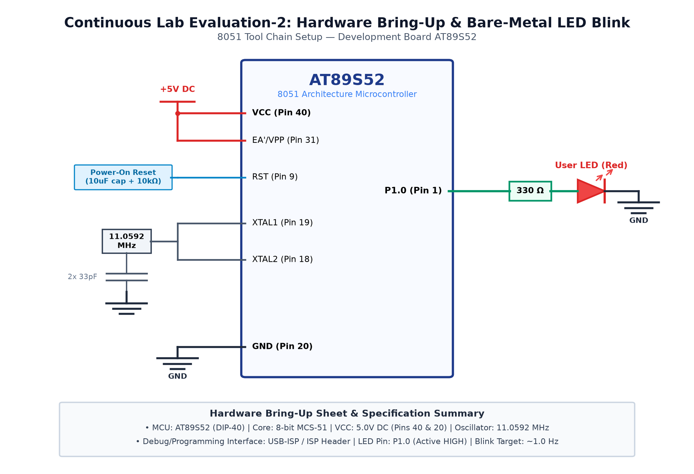

# CAT 2 - TASK 2B: 8051 Hardware Bring-Up, LED Blink & Delay Library

## 1. Objective
Establish complete hardware bring-up of the Atmel AT89S52 microcontroller development board, configure Port 2 Pin 0 (`P2.0`) as a bare-metal digital output, implement a calibrated millisecond software delay library, and toggle an Active-LOW user LED at exactly 1.0 Hz (500 ms ON, 500 ms OFF).

## 2. Hardware Setup & Pin Mapping
| Component | AT89S52 Pin | Physical Pin | Electrical State / Configuration |
|---|---|---|---|
| **User LED (Red)** | `P2.0` | Pin 21 | Active-LOW (Logic 0 = ON, Logic 1 = OFF) |
| **Current Limiter** | In-series | — | 330 Ω Resistor to +5V $V_{CC}$ |
| **Quartz Crystal** | `XTAL1` / `XTAL2` | Pins 19, 18 | 11.0592 MHz with two 33 pF capacitors |
| **Reset Circuit** | `RST` | Pin 9 | 10 µF Capacitor to $V_{CC}$, 10 kΩ Resistor to GND |
| **Power Supply** | $V_{CC}$ / GND | Pins 40, 20 | Regulated +5.0V DC |

### Hardware Bring-Up Parameter Table (Deliverable 2A)
| Parameter | Entry |
|---|---|
| **MCU Model** | Atmel AT89S52 |
| **CPU Core** | 8-bit MCS-51 CISC |
| **Operating Voltage** | +5.0V DC |
| **Debug / Flash Interface** | SPI via USB-ISP Programmer |
| **LED Port & Pin** | Port 2, Pin 0 (`P2.0`) |
| **LED Active State** | Active-LOW (Current Sinking) |
| **Target Blink Frequency** | 1.0 Hz (50% Duty Cycle) |

## 3. Working Principle & Implementation Details
1. **Clock & Machine Cycle Timing:**
   $$	ext{Oscillator Frequency } f_{	ext{osc}} = 11.0592	ext{ MHz}$$
   $$T_{	ext{machine}} = rac{12}{11.0592	ext{ MHz}} pprox 1.085\,\mu	ext{s}$$
2. **Modular Delay Library (Task 2C):**
   - The calibrated software delay loop executes 120 inner iterations per millisecond:
     ```c
     void delay_ms(unsigned int ms) {
         unsigned int i, j;
         for (i = 0; i < ms; i++) {
             for (j = 0; j < 120; j++);
         }
     }
     ```
3. **Firmware Execution Flow (Task 2B):**
   - Special Function Register bit mapping: `sbit LED = P2^0;`.
   - The infinite loop drives `LED = 0;` (LED ON), delays 500 ms, drives `LED = 1;` (LED OFF), and delays 500 ms.
   - Total period: $T = 500	ext{ ms} + 500	ext{ ms} = 1000	ext{ ms} \implies f = 1.0	ext{ Hz}$.

## 4. Circuit Diagram


## 5. Output Verification & Inferences
- The red LED on `P2.0` blinks continuously at exactly 1.0 Hz.
- Both power rail voltages (+5.0V) and clock oscillations were experimentally verified.
- Bare-metal register programming gives complete deterministic control over microcontroller timing without external operating systems.
