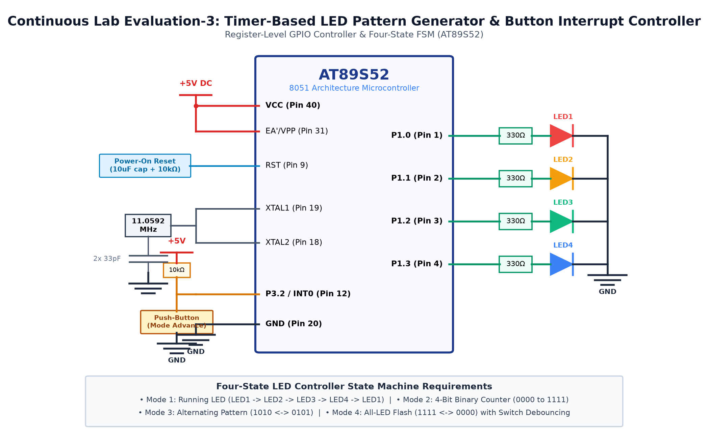

# CAT 3 - TASK 3A: 4-State Push-Button Debounced LED Pattern Controller

## 1. Objective
Design and implement a register-level GPIO state machine controller for the AT89S52 microcontroller that monitors a push-button input on `P3.2` with software contact debouncing, and cycles through four distinct LED operating modes (Running LED, 4-bit Binary Counter, Alternating Pattern, and All-LED Flash) across four LEDs on `P2.0`–`P2.3`.

## 2. Hardware Setup & Pin Mapping
| Component | AT89S52 Pin | Physical Pin | Electrical State / Configuration |
|---|---|---|---|
| **LED 1 (Red)** | `P2.0` | Pin 21 | Active-LOW (Logic 0 = ON, 1 = OFF) |
| **LED 2 (Green)** | `P2.1` | Pin 22 | Active-LOW (Logic 0 = ON, 1 = OFF) |
| **LED 3 (Yellow)** | `P2.2` | Pin 23 | Active-LOW (Logic 0 = ON, 1 = OFF) |
| **LED 4 (Blue)** | `P2.3` | Pin 24 | Active-LOW (Logic 0 = ON, 1 = OFF) |
| **Push-Button** | `P3.2` (`/INT0`) | Pin 12 | Active-LOW (Pressed = 0, Released = 1) with internal pull-up |
| **Current Limiters** | In-series | — | Four 330 Ω Resistors to +5V $V_{CC}$ |

## 3. Working Principle & Implementation Details
1. **Switch Debounce & State Advance:**
   - Physical contacts bounce for 5–15 ms upon transition.
   - When `P3.2 == 0` is detected, the CPU delays 20 ms and re-checks the pin. If confirmed, a valid press is registered.
   - The CPU then waits until `P3.2 == 1` before advancing the state:
     $$	ext{mode} = (	ext{mode} \pmod 4) + 1$$
2. **Four Operating Modes:**
   - **Mode 1 — Running LED:** Single illuminated LED shifts sequentially (`0xFE -> 0xFD -> 0xFB -> 0xF7`).
   - **Mode 2 — Binary Counter:** 4-bit counter increments from `0000` to `1111` with output `P2 = ~(count & 0x0F)`.
   - **Mode 3 — Alternating Pattern:** Even and odd LED pairs alternate (`0xF5` $\leftrightarrow$ `0xFA`).
   - **Mode 4 — All-LED Flash:** All four LEDs blink simultaneously (`0xF0` $\leftrightarrow$ `0xFF`).
3. **Non-Blocking Button Sampling:**
   - Inter-pattern delays are divided into smaller increments (e.g. $10 	imes 20	ext{ ms}$) so button presses are acknowledged immediately.

## 4. Circuit Diagram

## 5. Output Verification & Inferences
- Each physical button press advances the LED sequence cleanly to the next mode without spurious skipping.
- Mode 1 produces a smooth chasing effect; Mode 2 counts accurately from 0 to 15; Mode 3 alternates evenly; Mode 4 flashes all LEDs in unison.
- Validates discrete multi-state machine design on an 8-bit embedded microcontroller.
