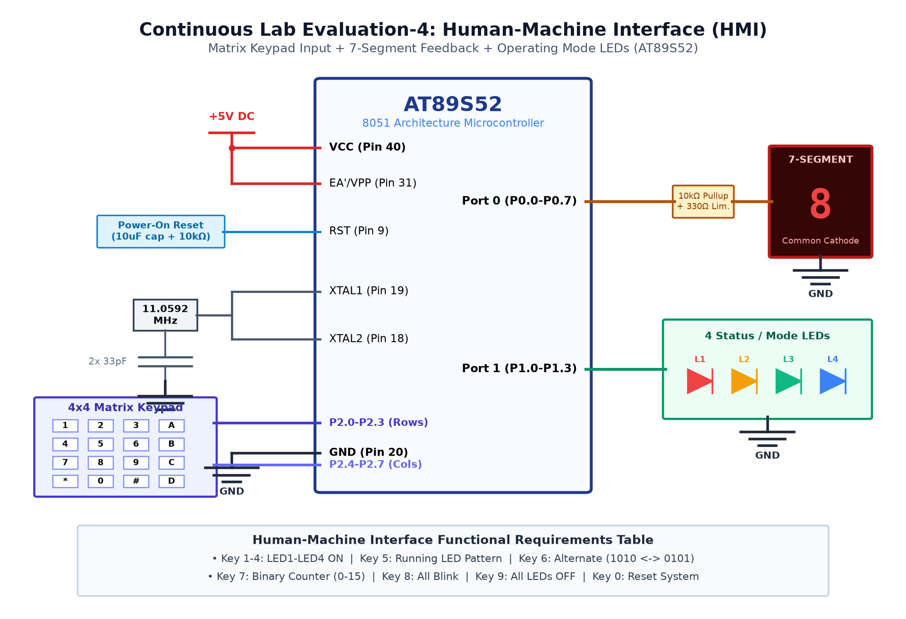

# CAT 4 - TASK 4A: Matrix Keypad Scanning, 7-Segment Display & LED HMI Controller

## 1. Objective
Design and implement an integrated Human-Machine Interface (HMI) embedded controller on the AT89S52 microcontroller consisting of a 4x4 matrix keypad input, a common anode 7-segment display feedback unit, and four peripheral LEDs that execute dedicated operating patterns based on the entered key.

## 2. Hardware Setup & Pin Mapping
| Component | AT89S52 Pin | Physical Pin | Function / Direction | Electrical State |
|---|---|---|---|---|
| **Keypad Rows (R1–R4)** | `P1.0`–`P1.3` | Pins 1–4 | Row Drive (Outputs) | Active-LOW scan strobe |
| **Keypad Cols (C1–C4)** | `P1.4`–`P1.7` | Pins 5–8 | Col Sense (Inputs) | Active-LOW with internal pull-up |
| **7-Segment Display** | `P0.0`–`P0.7` | Pins 39–32 | Segment Bus a–g, dp | Active-LOW (Common Anode) |
| **User LEDs (LED1–4)** | `P2.0`–`P2.3` | Pins 21–24 | Mode Indicator Outputs | Active-LOW |
| **Pull-Up Resistors** | `P0` Port Bus | Pins 39–32 | External 10 kΩ Resistor Pack | Required for Port 0 open-drain bus |

## 3. Working Principle & Implementation Details
1. **Keypad Scanning Algorithm (`keypad_scan`):**
   - Sequentially drives each row LOW (`0xFE`, `0xFD`, `0xFB`, `0xF7`) while keeping others HIGH.
   - Reads upper nibble `P1 & 0xF0`. When a LOW bit is sampled, a 20 ms software debounce confirms the event.
   - Waits for button release (`while ((P1 & 0xF0) != 0xF0);`) to prevent repeated triggers.
2. **7-Segment Display Feedback (`display_digit`):**
   - Translates numeric digits `0`–`9` into segment drive patterns via an active-LOW array:
     ```c
     code unsigned char seg_code[] = {0xC0, 0xF9, 0xA4, 0xB0, 0x99, 0x92, 0x82, 0xF8, 0x80, 0x90};
     ```
   - Drives `P0 = seg_code[key]`.
3. **LED Pattern Execution Engine (`led_control`):**
   - Key `1`–`4`: Single LED activation (`P2 = ~(1 << (key - 1))`).
   - Key `5`: Running LED pattern.
   - Key `6`: Alternating pattern (`0xF5` $\leftrightarrow$ `0xFA`).
   - Key `7`: 4-bit binary counter (`0` to `15`).
   - Key `8`: All-LED blink.
   - Key `9`: All LEDs OFF (`P2 = 0xFF`).
   - Key `0`: Reset state (`P0 = 0xC0`, `P2 = 0xFF`).

## 4. Circuit Diagram


## 5. Output Verification & Inferences
- Pressing any keypad key immediately renders the corresponding numeral on the 7-segment display.
- Keys 1–9 and 0 successfully trigger their respective individual, running, alternating, counter, or blink LED routines.
- Demonstrates effective multi-peripheral multiplexing and modular driver design.
