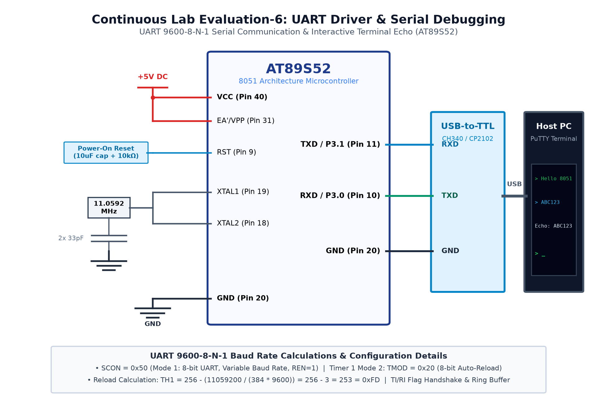

# CAT 6 - TASK 6A: UART 9600-8-N-1 String Transmission

## 1. Objective
Configure the 8051 UART serial peripheral at 9600 baud (8 Data Bits, 1 Stop Bit, No Parity) using Timer 1 in Mode 2 auto-reload, and transmit the text string `"Hello from 8051\r\n"` periodically to a PC serial terminal.

## 2. Hardware Setup & Pin Mapping
| Signal | 8051 Pin | USB-UART Bridge Pin | Parameter |
|---|---|---|---|
| **MCU TXD** | `P3.1` (Pin 11) | RXD | 115200 / 9600 bps Serial Data Out |
| **MCU RXD** | `P3.0` (Pin 10) | TXD | Serial Data In |
| **GND** | `GND` (Pin 20) | GND | Common reference ground |

## 3. Working Principle & Baud Rate Calculation
1. **Timer 1 Mode 2 Auto-Reload:**
   $$\text{Baud Rate} = \frac{1}{32} \times \frac{f_{osc}}{12 \times (256 - \text{TH1})}$$
   $$9600 = \frac{11059200}{384 \times (256 - \text{TH1})} \implies 256 - \text{TH1} = 3 \implies \text{TH1} = 253 = \text{0xFD}$$
2. **UART Configuration:**
   - `TMOD |= 0x20;` sets Timer 1 to 8-bit auto-reload.
   - `TH1 = 0xFD; TL1 = 0xFD; TR1 = 1;` initializes and starts the baud clock.
   - `SCON = 0x50;` selects Mode 1 (8-bit variable baud UART) and sets `REN = 1`.
3. **Transmission Loop:** Writing a character to `SBUF` initiates transmission. The program waits for `TI == 1`, clears `TI = 0;`, and proceeds to the next character in the string.

## 4. Circuit Diagram

## 5. Output Verification & Inferences
- PuTTY terminal running at 9600-8-N-1 displays `"Hello from 8051"` every 1 second cleanly with zero character corruption.
- Crystal frequency of 11.0592 MHz yields zero baud rate deviation.
