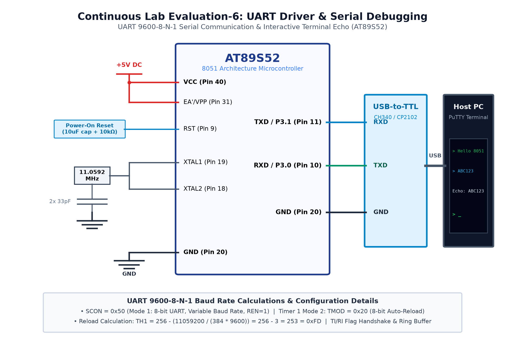

# CAT 6 - TASK 6B: Interactive Terminal Echo Engine

## 1. Objective
Implement an interactive full-duplex UART echo engine on the AT89S52 at 9600-8-N-1 that receives characters typed into a terminal emulator (PuTTY) and immediately transmits them back to the terminal screen.

## 2. Hardware Setup & Pin Mapping
| Signal | 8051 Pin | USB-to-TTL Serial Bridge |
|---|---|---|
| **TXD** | `P3.1` (Pin 11) | Connected to Bridge RXD |
| **RXD** | `P3.0` (Pin 10) | Connected to Bridge TXD |
| **GND** | `GND` (Pin 20) | Common ground plane |

## 3. Working Principle & Echo Logic
1. **Character Reception:**
   - The CPU polls the Receive Interrupt flag: `while (!RI);`.
   - When a full 10-bit serial frame (1 start, 8 data, 1 stop) arrives, hardware sets `RI = 1`.
   - The program reads `char c = SBUF;` and resets `RI = 0;`.
2. **Character Transmission:**
   - If Enter (`\r`) is received, the microcontroller transmits `\r\n` to advance the cursor cleanly.
   - Otherwise, `uart_tx_char(c)` writes the received character directly back to `SBUF`.

## 4. Circuit Diagram

## 5. Output Verification & Inferences
- Characters typed in PuTTY are reflected back onto the screen with imperceptible latency.
- Validates bidirectional hardware UART communication on the 8051 architecture.
