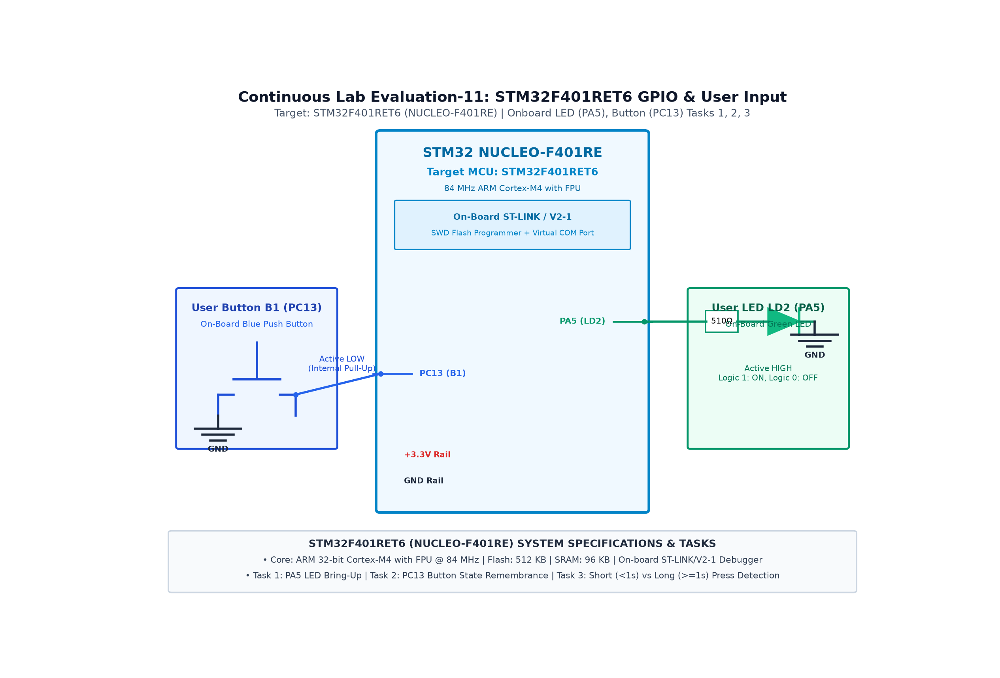

# CAT 11 - TASK 11A: User LED LD2 Bring-Up (1 Hz Blink)

## 1. Objective
Bring up the onboard green user LED (LD2) on Port A Pin 5 (`PA5`) of the STM32 NUCLEO-F401RE development board using STM32CubeMX and the HAL library, blinking the LED at a precise 1.0 Hz rate (500 ms ON, 500 ms OFF).

## 2. Hardware Setup & Pin Mapping
| Component | STM32 Pin | Mode | Electrical State |
|---|---|---|---|
| **User LED LD2 (Green)** | `PA5` | GPIO Output Push-Pull | Active-HIGH (1 = ON, 0 = OFF) |

## 3. Working Principle & Implementation Details
1. **Hardware Configuration:**
   - `PA5` is configured as a GPIO Output in Push-Pull mode with Low speed and No pull-up/pull-down resistors (`GPIO_NOPULL`).
   - The LED is tied to GND through a current limiter; driving `PA5` HIGH supplies current to light the LED.
2. **Periodic Toggling:**
   - Inside the main `while (1)` loop:
     `HAL_GPIO_TogglePin(GPIOA, GPIO_PIN_5);`
     `HAL_Delay(500);`
   - 500 ms HIGH + 500 ms LOW produces an exact period of 1000 ms ($1.0\text{ Hz}$).

## 4. Circuit Diagram

## 5. Output Verification & Inferences
- Green user LED LD2 blinks evenly at 1 Hz upon board power-up.
- Verifies successful clock initialization (HSI oscillator) and GPIO driver configuration.
