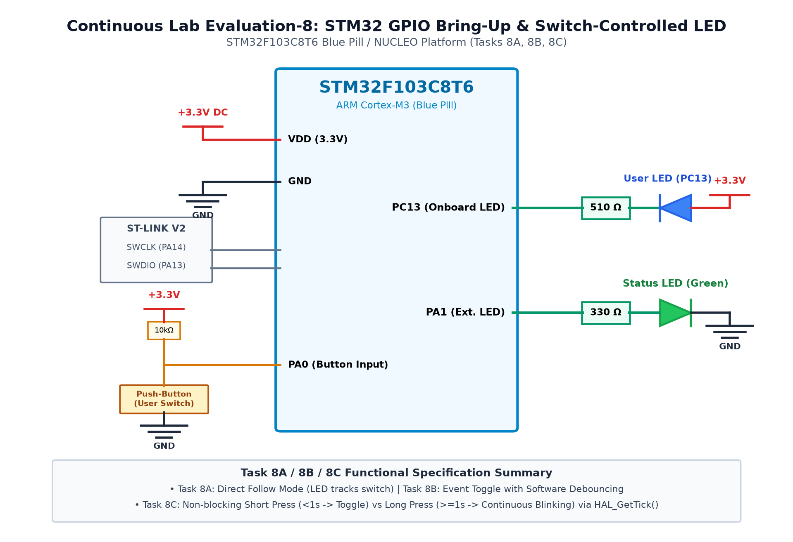

# CAT 8 - TASK 8A: GPIO Direct Follow Mode

## 1. Objective
Configure the STM32F103C8T6 (Blue Pill) GPIO peripherals using STM32CubeMX and the HAL library such that the onboard user LED on `PC13` immediately tracks the real-time state of an external push-button on `PA0` in direct follow mode.

## 2. Hardware Setup & Pin Mapping
| Component | STM32 Pin | Mode / Configuration | State Description |
|---|---|---|---|
| **Push-Button** | `PA0` | Input with Internal Pull-Up | Active-LOW (0 = Pressed, 1 = Released) |
| **Onboard LED** | `PC13` | Output Open-Drain / Push-Pull | Active-LOW (0 = LED ON, 1 = LED OFF) |

## 3. Working Principle & Implementation Details
1. **Direct Follow Logic:**
   - The button on `PA0` is pulled HIGH (+3.3V) through an internal pull-up resistor. Pressing the button connects `PA0` to GND (logic `0`).
   - The onboard LED on `PC13` is connected to VCC through a current-limiting resistor. Driving `PC13` LOW sinks current and illuminates the LED.
2. **Main Loop Execution:**
   - The program reads `HAL_GPIO_ReadPin(GPIOA, GPIO_PIN_0)`.
   - If `GPIO_PIN_RESET` (pressed), it calls `HAL_GPIO_WritePin(GPIOC, GPIO_PIN_13, GPIO_PIN_RESET)` to turn the LED ON.
   - If `GPIO_PIN_SET` (released), it calls `HAL_GPIO_WritePin(GPIOC, GPIO_PIN_13, GPIO_PIN_SET)` to turn the LED OFF.

## 4. Circuit Diagram

## 5. Output Verification & Inferences
- The `PC13` LED illuminates instantaneously when the `PA0` button is held down and turns OFF immediately upon release.
- Verifies basic digital input sampling and output actuation using the STM32 HAL API.
