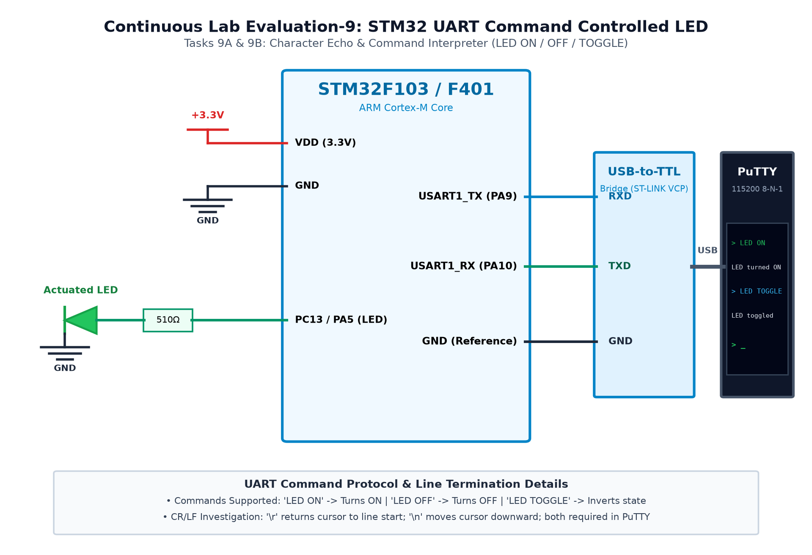

# CAT 9 - TASK 9A: USART2 Terminal Character Echo Engine

## 1. Objective
Configure the STM32F401RET6 USART2 peripheral at 115200-8-N-1 and implement an interactive full-duplex character echo engine that immediately reflects characters typed into a serial terminal (PuTTY) back to the PC screen while toggling user LED LD2.

## 2. Hardware Setup & Pin Mapping
| Signal | STM32 Pin | Interface | Parameters |
|---|---|---|---|
| **USART2 TX** | `PA2` | ST-LINK Virtual COM Port | 115200 Baud, 8-N-1 |
| **USART2 RX** | `PA3` | ST-LINK Virtual COM Port | 115200 Baud, 8-N-1 |
| **User LED** | `PA5` | Onboard Green LED LD2 | Active-HIGH activity strobe |

## 3. Working Principle & Implementation Details
1. **Virtual COM Port Link:** The onboard ST-LINK V2-1 debugger bridges STM32 pins `PA2` and `PA3` directly to the host PC via USB.
2. **Echo Logic:**
   - Transmits a startup banner: `"=== NUCLEO-F401RE USART2 Terminal Echo ===\r\n"`.
   - In each loop iteration, polls `HAL_UART_Receive(&huart2, &rx_char, 1, 10)` with a 10 ms timeout.
   - When a character is received (`HAL_OK`), immediately calls `HAL_UART_Transmit(&huart2, &rx_char, 1, 10)` to echo it back to the terminal.
   - Toggles `PA5` via `HAL_GPIO_TogglePin()` to provide visual feedback for every processed byte.

## 4. Circuit Diagram

## 5. Output Verification & Inferences
- Characters typed into PuTTY appear instantly on the screen with 100% fidelity.
- Onboard green LED LD2 blinks with each keystroke, validating physical hardware reception.
